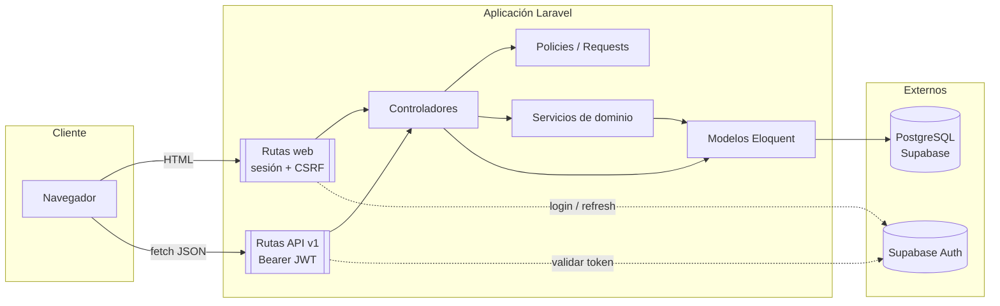

# Documentación de SkillApp

SkillApp (marca **"SoftSkills AI"** / **"SkillDiagnóstico IA"**) es una aplicación web
construida con Laravel para gestionar el **ciclo completo de habilidades blandas** en una
organización: catálogo de competencias, evaluaciones a colaboradores, diagnóstico
organizacional, brechas por área, planes de mejoramiento y su seguimiento.

Es una plataforma **multiempresa (multi-tenant)**: cada empresa ve únicamente sus
colaboradores, evaluaciones, diagnósticos y planes.

## Stack

| Componente | Versión / tecnología |
|---|---|
| Framework | Laravel 13.29 *(PHP `^8.3`)* |
| Lenguaje | PHP (probado en 8.3; el `composer.json` declara `^8.3`) |
| Base de datos | PostgreSQL (Supabase) — esquema `laravel` |
| Autenticación | Supabase Auth (JWT) + middleware propio |
| Frontend | Blade + Tailwind CSS 4 + Vite 8 |
| JS | Vanilla ES modules (sin framework SPA) |
| Tests | PHPUnit 12 + un test de navegador en `node:test` |
| Formato | Laravel Pint |

## Índice

| Documento | Contenido |
|---|---|
| [analisis-detallado.md](analisis-detallado.md) | Análisis detallado: módulos, lenguajes y qué se evalúa |
| [arquitectura.md](arquitectura.md) | Capas, estructura de carpetas y ciclo de una petición |
| [base-de-datos.md](base-de-datos.md) | Tablas, migraciones y modelo de datos |
| [api.md](api.md) | Endpoints REST `api/v1`, roles, validación y errores |
| [autenticacion-seguridad.md](autenticacion-seguridad.md) | Login con Supabase, roles, policies, aislamiento y cabeceras |
| [frontend.md](frontend.md) | Estructura Blade, módulos JS y capa de datos del workspace |
| [dominio-flujos.md](dominio-flujos.md) | Flujos de negocio: evaluación, diagnóstico, planes y notificaciones |
| [pruebas-habilidades-blandas.md](pruebas-habilidades-blandas.md) | Las tres pruebas exploratorias: contenido, uso y verificación |
| [desarrollo-despliegue.md](desarrollo-despliegue.md) | Configuración local, Supabase, comandos, tests y producción |
| [estado-y-pendientes.md](estado-y-pendientes.md) | Qué está implementado, deuda técnica y próximos pasos |

## Resumen de arquitectura

## Convenciones del proyecto

- La lógica de negocio compleja vive en `app/Services`; los controladores coordinan.
- Las entradas se validan con **Form Requests** en `app/Http/Requests`.
- Los permisos se centralizan en **Policies** y en el middleware `role`.
- Todas las tablas se crean mediante **migraciones**; no se edita la base a mano.
- La documentación de arquitectura y reglas del repo vive en esta carpeta y en `AGENTS.md`.
