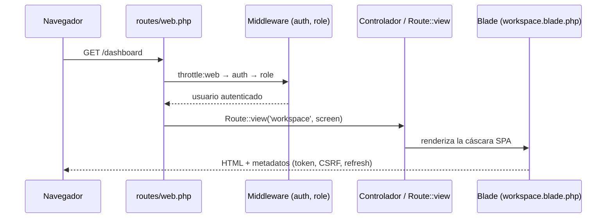
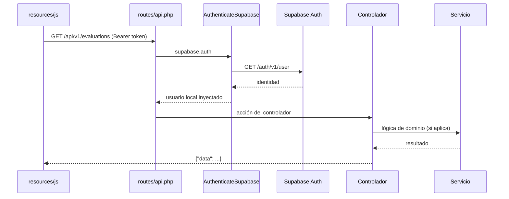

# Arquitectura

## Visión general

SkillApp separa claramente **transporte (web/API)**, **orquestación (controladores)**,
**reglas de negocio (servicios)**, **presentación (Blade + JS)** y **persistencia
(Eloquent/PostgreSQL)**. No se usan abstracciones vacías: las capas existen porque hay una
necesidad concreta.

## Capas y responsabilidades

| Capa | Ubicación | Responsabilidad |
|---|---|---|
| Rutas | `routes/web.php`, `routes/api.php`, `routes/console.php` | Conectan URLs con controladores; sin lógica de negocio |
| Controladores | `app/Http/Controllers` | Coordinan autorización, validación y respuesta |
| Form Requests | `app/Http/Requests` | Validación y reglas de entrada |
| Policies | `app/Policies` | Autorización por recurso (aislamiento por empresa) |
| Servicios | `app/Services` | Lógica de negocio reutilizable y transaccional |
| Contratos | `app/Contracts` | Interfaces de dependencias intercambiables (IA) |
| Modelos | `app/Models` | Relaciones, casts y consultas reutilizables |
| Enums | `app/Enums` | Estados y tipos tipados de dominio |
| Notificaciones | `app/Notifications` | Notificaciones de base de datos |
| Middleware | `app/Http/Middleware` | Autenticación, roles y cabeceras de seguridad |
| Vistas | `resources/views` | Presentación (Blade), sin acceso a base de datos |

## Estructura de `app/`

```text
app/
├── Contracts/            AssessmentAnalyzer (interfaz de análisis IA)
├── Enums/                9 enums de dominio (roles, estados, tipos)
├── Http/
│   ├── Controllers/
│   │   ├── Api/V1/       12 controladores REST
│   │   └── Web/          Sesión web + controlador de inicio
│   ├── Middleware/       AuthenticateSupabase, EnsureRole, SecurityHeaders
│   └── Requests/
│       ├── Api/V1/       14 Form Requests
│       └── Web/          LoginRequest
├── Models/               21 modelos Eloquent
├── Notifications/        3 notificaciones de base de datos
├── Policies/             4 policies (Company, Evaluation, ImprovementPlan, Question)
├── Providers/            AppServiceProvider (binding IA, rate limiters, Eloquent estricto)
└── Services/             Authentication, SupabaseAuth, Evaluation, Diagnostic, NullAssessmentAnalyzer
```

## Ciclo de una petición

### Petición web (HTML)



### Petición API (JSON)



## Patrón multiempresa

El aislamiento se aplica en tres niveles complementarios:

1. **Middleware `supabase.auth`** — resuelve el usuario local a partir del token y lo
   fija como usuario de la petición (`Auth::setUser`).
2. **Middleware `role`** — bloquea rutas completas según rol
   (`superadmin`, `human_resources`, `collaborator`).
3. **Policies y consultas filtradas** — las listas se filtran por `company_id` y el
   acceso puntual a un recurso ajeno responde `404` para no revelar existencia.

```php
// Ejemplo de filtro por empresa (AreaController@index)
$query->when($request->integer('company_id'), fn ($q, int $id) => $q->where('company_id', $id));
if (! $request->user()->isSuperadmin()) {
    $query->where('company_id', $request->user()->company_id);
}
```

## Servicios de dominio

| Servicio | Responsabilidad |
|---|---|
| `AuthenticationService` | Inicia sesión contra Supabase y resuelve el usuario local |
| `SupabaseAuthService` | Cliente HTTP de Supabase Auth (sign-in, refresh, recover, user, invite) |
| `EvaluationService` | Asignar, responder y completar evaluaciones; calcula resultados |
| `DiagnosticService` | Genera matriz de diagnóstico y brechas organizacionales |
| `NullAssessmentAnalyzer` | Implementación nula de `AssessmentAnalyzer` (punto de extensión IA) |

El binding de la IA vive en `AppServiceProvider`:

```php
$this->app->singleton(AssessmentAnalyzer::class, NullAssessmentAnalyzer::class);
```

Para conectar un motor real (OpenAI, Gemini, etc.) basta crear otra implementación de
`AssessmentAnalyzer` y cambiar el binding. Ver [dominio-flujos.md](dominio-flujos.md).

## Decisiones de diseño

- **Sin capa `Resources`**: los controladores devuelven modelos/campos directamente. Es un
  punto de mejora (ver [estado-y-pendientes.md](estado-y-pendientes.md)).
- **Servicios explícitos** en lugar de *Actions*: hay pocos servicios y con mucha lógica.
- **Eloquent estricto fuera de producción**: `Model::shouldBeStrict()` detecta N+1,
  atributos descartados y accesos inválidos en desarrollo.
- **Comandos destructivos de BD bloqueados en producción** (`DB::prohibitDestructiveCommands`).
