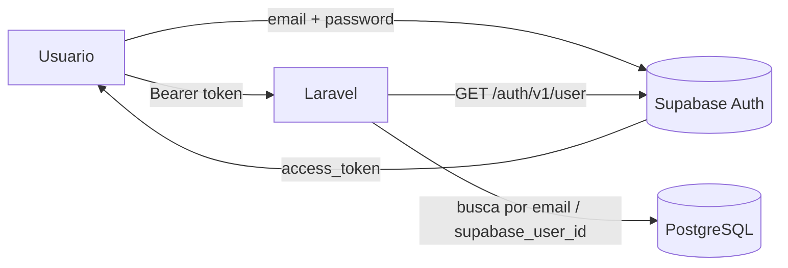
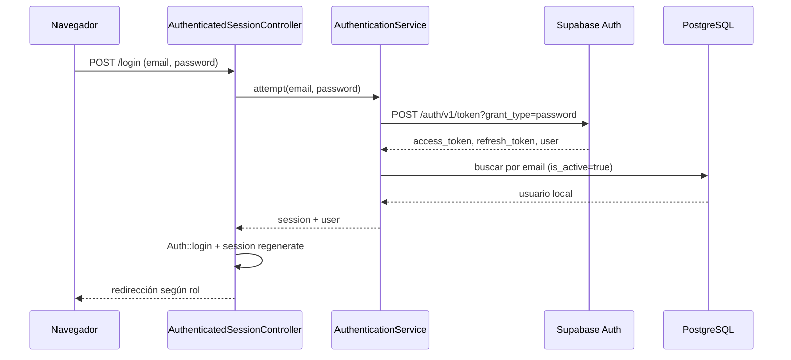

# Autenticación y seguridad

## Modelo de identidad

Laravel **no autentica con contraseñas locales**. La identidad se delega a **Supabase Auth**,
y PostgreSQL solo guarda el **perfil y el rol** del usuario.



Consecuencias prácticas:

- La contraseña se crea y se cambia en Supabase, no en la tabla `users`.
- La columna `users.password` existe (heredada de Laravel) pero **no se usa** para login.
- Un usuario debe existir **en Supabase Auth y en `users`** con el mismo correo.

### Enlace de la cuenta

El middleware y el login resuelven el usuario local con esta lógica:

1. Buscar por `supabase_user_id`.
2. Si no hay coincidencia, buscar por `email` con `supabase_user_id` nulo.
3. La primera vez, se rellena `supabase_user_id` y `last_login_at`.
4. Si `users.is_active = false`, el acceso se rechaza con `403`.

## Login web



- El token se guarda **en sesión** (`session('supabase')`) y se expone al frontend como
  `meta[name=api-access-token]`.
- **Redirección por rol:** el `collaborator` va a `personal.workspace` (`/mi-espacio`); el
  resto a `workspace` (`/dashboard`).
- **Errores genéricos:** credenciales inválidas devuelven siempre el mismo mensaje para no
  filtrar qué campo falla, y nunca se conserva la contraseña en `old()`.
- **Renovación:** `POST /session/refresh` usa el `refresh_token` de la sesión y actualiza el
  token. El JS reintenta automáticamente una vez ante un `401`.

La validación del formulario (`LoginRequest`) se ejecuta **antes** de contactar a Supabase.

## API (Bearer token)

El middleware `AuthenticateSupabase` (`supabase.auth`):

1. Exige `Authorization: Bearer`.
2. Llama a `GET /auth/v1/user` en Supabase.
3. Resuelve el usuario local (ver “Enlace de la cuenta”).
4. Fija el usuario con `Auth::setUser(...)` y `setUserResolver(...)`.

Errores que devuelve:

| Situación | Respuesta |
|---|---|
| Sin token / token inválido | `401` |
| Supabase inalcanzable (`ConnectionException`) | `503` |
| Cuenta no habilitada localmente | `403` |

## Roles

| Rol | Alcance |
|---|---|
| `superadmin` | Administra empresas y todo el catálogo; ve todas las empresas |
| `human_resources` | Gestiona catálogo, colaboradores, evaluaciones y diagnósticos de **su** empresa |
| `collaborator` | Solo su información: evaluaciones, resultados, plan y notificaciones |

### Navegación web

| Sección | Rutas | Roles |
|---|---|---|
| Inicio / sesión | `/`, `/login`, `/logout`, `/session/refresh` | público / autenticado |
| Personal | `/mi-espacio`, `/mi-perfil`, `/notificaciones` | autenticado |
| Evaluación personal | `/mi-evaluacion`, `/mi-resultados`, `/mi-plan`, `/mi-progreso` | autenticado |
| Gestión | `/dashboard`, `/colaboradores`, `/evaluaciones`, `/habilidades`, `/preguntas`, `/cargos`, `/diagnostico-organizacional`, `/mapa-calor`, `/brechas`, `/recomendaciones`, `/planes`, `/seguimiento`, `/reportes`, `/areas` | `superadmin`, `human_resources` |
| Empresas | `/empresas` | `superadmin` |

Todas las vistas de gestión usan la misma plantilla `workspace.blade.php`, parametrizada por
`screen`. El bloqueo por rol lo aplica el middleware en la ruta, no el Blade.

## Policies

| Policy | Modelo | Notas |
|---|---|---|
| `CompanyPolicy` | `Company` | `before()` deja pasar al `superadmin`; el resto por empresa |
| `EvaluationPolicy` | `Evaluation` | El colaborador solo ve/edita la suya; gestión por empresa |
| `ImprovementPlanPolicy` | `ImprovementPlan` | Igual criterio que evaluaciones |
| `QuestionPolicy` | `Question` | Gestión del banco de preguntas por empresa |

Los controladores llaman `$this->authorize(...)` antes de devolver o modificar recursos.

## Aislamiento multiempresa

Además de las policies, las consultas de listado filtran explícitamente:

```php
if (! $user->isSuperadmin()) {
    $query->where('company_id', $user->company_id);
}
```

En accesos puntuales, un recurso de otra empresa responde **`404`** (no `403`) para no
revelar su existencia:

```php
abort_unless($request->user()->isSuperadmin() || $area->company_id === $request->user()->company_id, 404);
```

Los tests `ApiTenantIsolationTest` cubren este comportamiento.

## Cabeceras de seguridad

`SecurityHeaders` (aplicado globalmente) añade, según `config/security.php`:

| Cabecera | Valor |
|---|---|
| `X-Content-Type-Options` | `nosniff` |
| `X-Frame-Options` | `SAMEORIGIN` |
| `Referrer-Policy` | `strict-origin-when-cross-origin` |
| `Permissions-Policy` | `camera=(), geolocation=(), microphone=()` |
| `Cross-Origin-Opener-Policy` | `same-origin` |

- **CSP:** se añade a respuestas HTML cuando `SECURITY_CSP_ENABLED=true` (por defecto en
  producción). Restringe `default-src`, `script-src` y `frame-ancestors` a `'self'`.
- **HSTS:** se añade solo en respuestas HTTPS cuando `SECURITY_HSTS_ENABLED=true`.

## Rate limiting

Definido en `AppServiceProvider` con límites configurables:

| Limiter | Clave | Uso | Variable |
|---|---|---|---|
| `web` | usuario o IP | rutas web | `WEB_RATE_LIMIT_PER_MINUTE` (120) |
| `api` | usuario o IP | API protegida | `API_RATE_LIMIT_PER_MINUTE` (60) |
| `auth` | email + IP | login, refresh, recover, invite | `AUTH_RATE_LIMIT_PER_MINUTE` (10) |

## Endurecimiento del entorno

- `Model::shouldBeStrict()` fuera de producción: detecta N+1, atributos descartados y
  accesos a propiedades inexistentes.
- `DB::prohibitDestructiveCommands()` en producción: bloquea `migrate:fresh` y similares.
- `trustHosts` con `APP_TRUSTED_HOSTS`: evita ataques por cabecera `Host`.
- Sesiones cifradas (`SESSION_ENCRYPT=true`), cookie `HttpOnly` y `SameSite=lax`.
- Los tests usan `Http::fake()` para no salir a internet por accidente.

## Invitaciones de colaboradores

`POST /api/v1/employees/{employee}/invite` usa `SupabaseAuthService::invite()`, que requiere
`SUPABASE_SERVICE_ROLE_KEY`. Si no está configurada, responde `503`
(`Supabase Service Role no está configurado`).

> **Seguridad:** la `service_role` salta RLS y tiene control total del proyecto Supabase. Debe
> vivir únicamente en `.env` (ignorado por git) y nunca en `.env.example`, PHP, JS o Blade.
