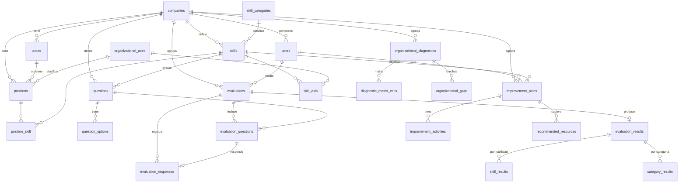

# Base de datos

## Motor y conexión

- **Motor:** PostgreSQL alojado en **Supabase**.
- **Esquema de la aplicación:** `laravel` (separado del esquema público de Supabase).
- **Driver:** `pgsql`, SSL obligatorio (`DB_SSLMODE=require`).
- **Conexión recomendada:** **Session Pooler** (IPv4, puerto `5432`), porque la conexión
  directa de Supabase es solo IPv6.

```dotenv
DB_CONNECTION=pgsql
DB_HOST=aws-0-<region>.pooler.supabase.com
DB_PORT=5432
DB_DATABASE=postgres
DB_USERNAME=postgres.<PROJECT_REF>
DB_PASSWORD=<contraseña>
DB_SCHEMA=laravel
DB_SSLMODE=require
```

Antes de migrar hay que crear el esquema una vez, desde el SQL Editor de Supabase:

```sql
create schema if not exists laravel;
```

Todas las tablas se crean con migraciones (`database/migrations`). Ver el procedimiento
completo en [desarrollo-despliegue.md](desarrollo-despliegue.md).

## Migraciones

| Migración | Tablas |
|---|---|
| `0001_01_01_000000_create_users_table` | `users`, `password_reset_tokens`, `sessions` |
| `0001_01_01_000001_create_cache_table` | `cache`, `cache_locks` |
| `0001_01_01_000002_create_jobs_table` | `jobs`, `job_batches`, `failed_jobs` |
| `2026_08_29_190913_create_platform_catalogs_tables` | `companies`, `organizational_axes`, `skill_categories` |
| `2026_08_29_190914_create_organization_tables` | `areas`, `positions` |
| `2026_08_29_190915_adapt_users_for_supabase_auth` | altera `users` (auth Supabase + perfil) |
| `2026_08_29_190916_create_skills_tables` | `skills`, `skill_axis`, `position_skill`, `questions`, `question_options` |
| `2026_08_29_190917_create_evaluation_tables` | `evaluations`, `evaluation_questions`, `evaluation_responses`, `evaluation_results`, `skill_results`, `category_results` |
| `2026_08_29_190918_create_improvement_tables` | `improvement_plans`, `improvement_activities`, `recommended_resources` |
| `2026_08_29_190919_create_diagnostics_tables` | `organizational_diagnostics`, `diagnostic_matrix_cells`, `organizational_gaps` |
| `2026_08_29_190920_create_notifications_table` | `notifications` |
| `2026_10_15_174843_create_assessment_instruments_tables` | `assessments`; añade `questions.assessment_id/code/display_order` y `evaluations.assessment_id`; hace `questions.company_id` nullable |

## Catálogos globales vs datos de empresa

El modelo distingue dos clases de datos:

- **Catálogos globales de la plataforma** (sin `company_id`): `organizational_axes`,
  `skill_categories`. Se cargan con el seeder base.
- **Datos por empresa** (con `company_id`): áreas, cargos, habilidades, preguntas,
  evaluaciones, diagnósticos y planes.

`skills` y `questions` tienen `company_id` **nullable**: permiten contenido global
(plataforma) o específico de una empresa. En las validaciones se acepta
`whereNull('company_id')->orWhere('company_id', $companyId)`.

## Modelo de datos



## Tablas principales

### Identidad y organización

| Tabla | Columnas clave |
|---|---|
| `users` | `supabase_user_id` (uuid, único), `company_id`, `position_id`, `manager_id`, `email`, `role`, `is_active`, `last_login_at`, soft deletes |
| `companies` | `name`, `nit` (único), `sector`, `logo_path`, `is_active`, `settings` (jsonb), soft deletes |
| `areas` | `company_id`, `name`, `code`, `is_active`; único `(company_id, name)` |
| `positions` | `company_id`, `area_id`, `organizational_axis_id`, `name`; único `(company_id, name)` |

### Catálogo de habilidades

| Tabla | Columnas clave |
|---|---|
| `skill_categories` | `code` (único), `name`, `description`, `is_active` |
| `organizational_axes` | `code` (único), `name`, `description`, `is_active` |
| `skills` | `company_id` (nullable), `skill_category_id`, `name`, `target_level` |
| `skill_axis` | pivote N:M `skill_id` ↔ `organizational_axis_id` |
| `position_skill` | pivote `position_id` ↔ `skill_id` con `weight` y `required_level` |
| `questions` | `company_id`, `skill_id`, `organizational_axis_id`, `type`, `difficulty`, `text` |
| `question_options` | `question_id`, `label`, `text`, `score`, `display_order` |

### Pruebas de habilidades blandas

| Tabla / columna | Detalle |
|---|---|
| `assessments` | Instrumento: `code` (único), `name`, `description`, `organizational_axis_id`, `is_active` |
| `questions.assessment_id` | Prueba a la que pertenece la pregunta (nullable) |
| `questions.code` | Identificador estable del ítem (ej. `OPERATIVE_SKILLS_V1-S1Q2`) |
| `questions.display_order` | Orden de presentación dentro de la prueba |
| `evaluations.assessment_id` | Prueba aplicada en esa evaluación |

Ver el detalle y el contenido de las tres pruebas en
[pruebas-habilidades-blandas.md](pruebas-habilidades-blandas.md).

### Evaluaciones

| Tabla | Columnas clave |
|---|---|
| `evaluations` | `company_id`, `user_id`, `assigned_by`, `parent_evaluation_id`, `assessment_id`, `type`, `status`, `question_count`, `assigned_at`, `due_at`, `completed_at` |
| `evaluation_questions` | `evaluation_id` + `question_id` (único), `display_order` |
| `evaluation_responses` | `evaluation_id` + `evaluation_question_id` (único), `question_option_id`, `likert_value`, `score` |
| `evaluation_results` | `evaluation_id` (único), `total_score`, `level`, `ai_analysis`, `strengths`, `opportunities`, `model_confidence`, `immutable_at` |
| `skill_results` | `evaluation_result_id` + `skill_id`, `score`, `level` |
| `category_results` | `evaluation_result_id` + `skill_category_id`, `score`, `level` |

`evaluation_results` es **inmutable**: una vez calculado tiene `immutable_at`, y el servicio
no recalcula si ya existe.

### Mejoramiento

| Tabla | Columnas clave |
|---|---|
| `improvement_plans` | `company_id`, `user_id`, `skill_id`, `initial_level`, `target_level`, `progress`, `status`, `reevaluation_date`, `ai_recommendation` |
| `improvement_activities` | `improvement_plan_id`, `title`, `duration_minutes`, `status`, `display_order` |
| `recommended_resources` | `improvement_plan_id`, `improvement_activity_id`, `type`, `url`, `recommended_by_ai` |

### Diagnóstico organizacional

| Tabla | Columnas clave |
|---|---|
| `organizational_diagnostics` | `company_id`, `generated_by`, `period_start`, `period_end`, `total_evaluated`, `snapshot`, `closed_at`; único por período |
| `diagnostic_matrix_cells` | eje × categoría con `average_score`, `level`, `evaluated_count` |
| `organizational_gaps` | `skill_id`, `organizational_axis_id`, `area_id`, `priority`, `affected_count`, `score_gap`, `status` |

### Infraestructura

`notifications` (notificaciones de Laravel, polimórfica), `sessions`, `cache`, `jobs` y
`password_reset_tokens` son tablas de framework.

## Enums de dominio

Los estados se guardan como `string` en la base pero se castean a enums de PHP:

| Enum | Valores |
|---|---|
| `UserRole` | `superadmin`, `human_resources`, `collaborator` |
| `EvaluationStatus` | `pending`, `in_progress`, `completed`, `expired` |
| `EvaluationType` | `initial`, `reevaluation` |
| `ImprovementPlanStatus` | `pending`, `in_progress`, `completed`, `cancelled` |
| `ImprovementActivityStatus` | `pending`, `in_progress`, `completed` |
| `GapPriority` | `low`, `medium`, `high`, `critical` |
| `QuestionType` | `self_report`, `situational`, `situational_judgment` |
| `QuestionDifficulty` | `basic`, `intermediate`, `advanced` |
| `ResourceType` | `reading`, `video`, `exercise` |

## Seeders y factories

- `DatabaseSeeder` carga los catálogos globales: 3 ejes (`operational`, `mission`,
  `strategic`) y 4 categorías (`communication`, `collaboration`, `cognitive`, `leadership`).
- Hay **21 factories** en `database/factories` para los modelos de dominio, usadas por los
  tests de feature.
