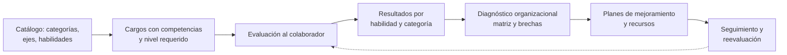

# Dominio y flujos de negocio

## Ciclo de vida del talento



## 1. Catálogo de habilidades

- `SkillCategory` agrupa habilidades (comunicativas, colaborativas, cognitivas, dirección).
- `OrganizationalAxis` clasifica por eje (operativo, misional, estratégico).
- Una `Skill` pertenece a una categoría y se relaciona con uno o varios ejes (`skill_axis`).
- Un `Position` (cargo) pertenece a un `Area` y a un eje, y define sus competencias con
  **peso** y **nivel requerido** (`position_skill`).
- Las `Question` cuelgan de una habilidad y, opcionalmente, de un eje. Tienen tipo
  (`self_report`, `situational`, `situational_judgment`), dificultad y opciones con puntaje.

## 2. Evaluaciones

### Asignar (`EvaluationService::assign`)

1. Resuelve el colaborador y verifica que pertenezca a la empresa del actor.
2. Si no se envían preguntas explícitas, las **selecciona automáticamente**:
   - toma las habilidades del **cargo** del colaborador,
   - filtra preguntas activas de la empresa para esas habilidades,
   - acepta preguntas sin eje o del eje del cargo,
   - elige `question_count` al azar.
3. Valida que todas las preguntas existan, estén activas y sean de la empresa.
4. Si es **reevaluación**, exige una evaluación **completada** previa del mismo colaborador.
5. Crea la evaluación (`pending`) y sus `evaluation_questions` con orden de presentación.
6. Notifica al colaborador tras el commit.

### Responder (`EvaluationService::respond`)

- Rechaza evaluaciones completadas (inmutables) o vencidas (las marca `expired`).
- Valida que la pregunta pertenezca a la evaluación.
- Reglas por tipo:
  - `self_report` exige `likert_value` (1–5).
  - `situational` / `situational_judgment` exigen `question_option_id` válido.
- Al responder la primera pregunta, la evaluación pasa a `in_progress`.
- Usa `updateOrCreate`: se puede corregir una respuesta mientras esté abierta.

### Completar (`EvaluationService::complete`)

1. Toma un lock (`lockForUpdate`) para evitar dobles cálculos simultáneos.
2. Si ya existe resultado, lo devuelve (**idempotente**).
3. Exige que estén **todas** las preguntas respondidas.
4. Calcula `total_score` (promedio) y el `level`.
5. Llama al analizador de IA (`AssessmentAnalyzer`) para `ai_analysis`, `strengths`,
   `opportunities` y `model_confidence`.
6. Genera resultados por **habilidad** (`skill_results`) y por **categoría** (`category_results`).
7. Marca la evaluación como `completed` con `completed_at`.

### Escala de niveles

| Puntaje (1–5) | Nivel |
|---|---|
| ≥ 4.5 | `outstanding` (Sobresaliente) |
| ≥ 3.5 | `strong` (Sólido) |
| ≥ 2.5 | `developing` (En desarrollo) |
| < 2.5 | `critical` (Crítico) |

## 3. Diagnóstico organizacional

`DiagnosticService::generate` (roles de gestión) construye una **foto agregada** por período:

1. Valida empresa y evita duplicar un diagnóstico para el mismo `(empresa, período)`.
2. Recoge las evaluaciones **completadas** dentro del período.
3. Si no hay evaluaciones, rechaza la operación.
4. En una transacción crea el diagnóstico con un `snapshot` (ids, promedio, fecha).
5. **Matriz:** agrupa respuestas por `eje × categoría` y guarda el promedio en
   `diagnostic_matrix_cells` (con `evaluated_count`).
6. **Brechas:** por cada resultado de habilidad compara el `required_level` del cargo con el
   puntaje obtenido; agrupa por `(habilidad, eje, área)` y calcula el promedio de brecha.

| Brecha promedio | Prioridad |
|---|---|
| ≥ 2.0 | `critical` |
| ≥ 1.5 | `high` |
| ≥ 1.0 | `medium` |
| < 1.0 | `low` |

La brecha alimenta las pantallas de mapa de calor, brechas y recomendaciones.

## 4. Planes de mejoramiento

- Un plan liga un colaborador con una habilidad objetivo (`initial_level`, `target_level`),
  fechas y estado.
- Se puede crear con **actividades** y **recursos recomendados** anidados en una sola petición.
- `POST .../activities/{activity}/complete` marca la actividad como completada, recalcula
  `progress = completadas / total × 100` y actualiza el estado (`in_progress` → `completed`).
  Solo el dueño del plan puede completar sus actividades.
- `reevaluation_date` alimenta el recordatorio programado.
- Los recursos tienen `recommended_by_ai` para distinguir sugerencias automáticas.

## 5. Notificaciones y tareas programadas

Tres notificaciones de base de datos (canal `database`):

| Notificación | Se dispara |
|---|---|
| `EvaluationAssignedNotification` | Al asignar una evaluación |
| `ImprovementPlanAssignedNotification` | Al crear un plan de mejoramiento |
| `ReevaluationDueNotification` | El día de `reevaluation_date` |

`routes/console.php` programa dos tareas:

| Tarea | Frecuencia | Acción |
|---|---|---|
| `expire-evaluations` | cada hora | Marca `expired` las evaluaciones `pending`/`in_progress` con `due_at` vencido |
| `send-reevaluation-reminders` | diaria a `REEVALUATION_NOTIFICATION_TIME` (zona `BUSINESS_TIMEZONE`) | Notifica a los dueños de planes cuya `reevaluation_date` es hoy |

Ambas usan `withoutOverlapping()`. Requieren que el **scheduler** esté corriendo
(`php artisan schedule:work` o cron en producción).

## 6. Puntos de extensión de IA

El análisis inteligente está **preparado pero no implementado**. El contrato es:

```php
// app/Contracts/AssessmentAnalyzer.php
public function analyze(array $context): array;
// => ['analysis' => ?string, 'strengths' => array, 'opportunities' => array, 'confidence' => ?float]
```

El binding por defecto es `NullAssessmentAnalyzer`, que devuelve `null`/vacíos. Para activar
la IA real:

1. Crea una implementación (por ejemplo `OpenAiAssessmentAnalyzer`).
2. Cambia el binding en `AppServiceProvider`:

```php
$this->app->singleton(AssessmentAnalyzer::class, OpenAiAssessmentAnalyzer::class);
```

Los campos de destino ya existen: `evaluation_results.ai_analysis`, `strengths`,
`opportunities`, `model_confidence`, y `organizational_gaps.ai_recommendation` /
`organizational_diagnostics.ai_recommendations`.
