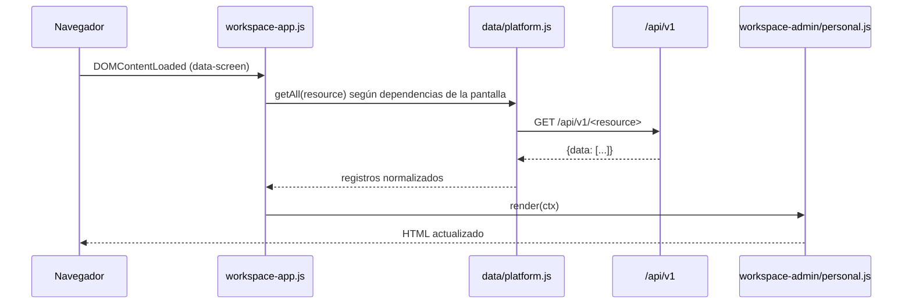

# Frontend

## Stack

- **Blade** para el HTML inicial (cáscara de la aplicación).
- **Tailwind CSS 4** vía `@tailwindcss/vite` (plugin nativo de Vite).
- **Vite 8** como bundler (`laravel-vite-plugin`).
- **JavaScript vanilla** (ES modules) para la interactividad; no hay Vue/React/Livewire.

```json
// vite.config.js (entradas)
"input": ["resources/css/app.css", "resources/js/app.js"]
```

## Cómo funcionan las pantallas

Todas las pantallas autenticadas renderizan **la misma vista**, `resources/views/workspace.blade.php`,
parametrizada por la variable `screen`:

```php
Route::view('/dashboard', 'workspace', ['screen' => 'dashboard'])->name('workspace');
Route::view('/colaboradores', 'workspace', ['screen' => 'colaboradores'])->name('collaborators.index');
```

El Blade:

1. Elige la navegación según el rol (`collaborator` vs. gestión).
2. Publica metadatos en `<meta>`: `csrf-token`, `api-access-token` (token de Supabase),
   `session-refresh-url` y `login-url`.
3. Marca el `<body>` con `data-workspace`, `data-screen` y `data-role`.
4. Monta el contenedor `#workspace-page`, el diálogo `#workspace-dialog` y el buscador
   global.

El JS lee `data-screen` y `data-role` y renderiza la pantalla correspondiente **en el
cliente**, pidiendo datos a la API REST.

## Módulos JavaScript

```text
resources/js/
├── app.js                  Punto de entrada: importa los módulos activos
├── data/
│   ├── platform.js         Capa de datos: fetch a /api/v1, refresh de sesión, paginación
│   └── collaborators.js    Carga y normaliza datos de colaboradores
├── workspace-ui.js         Utilidades de UI: labels, badges, KPIs, gráficas, tablas
├── workspace-app.js        Controlador del workspace (navegación, carga, render)
├── workspace-admin.js      Pantallas de administración (dashboard, catálogos, reportes)
├── workspace-personal.js   Pantallas del colaborador (evaluación, resultados, plan)
├── workspace-forms.js      Formularios y acciones (crear/editar registros)
├── collaborators.js        Vista legacy de colaboradores
├── skills.js               Vista legacy de habilidades
├── dashboard.js            Vista legacy del dashboard
├── records.js              Generación de tablas legacy
└── workspace.js            Navegación legacy (no incluido en el bundle)
```

### Capa de datos — `data/platform.js`

Es el único punto que habla con la API:

- `requestData(resource, {method, data, signal})`: hace `fetch('/api/v1/<resource>')` con
  `Authorization: Bearer` tomado del `<meta name="api-access-token">`.
- **Reintento automático:** ante un `401`, llama a `session-refresh-url`, actualiza el meta
  token y reintenta **una sola vez**.
- `getAll(resource)`: pagina automáticamente (`per_page=100`) hasta la última página.
- Traduce códigos de error a mensajes en español (`401`, `403`, `429`, …).
- Expone utilidades: `escapeHtml`, `normalize` (sin acentos, para búsquedas) y `axisTone`.

### Utilidades de UI — `workspace-ui.js`

Helpers de render (HTML como string, con escape sistemático):

- `e` / `escapeHtml` — escapado de texto (evita XSS).
- `label`, `badge`, `statusBadge`, `axisBadge`, `percent`, `date`, `color`.
- `panel`, `empty`, `button`, `link`, `progress`, `kpis`, `table`, `filter`, `bars`,
  `lineChart`, `select`, `input`, `textarea`.
- `icons` / `svg()` — íconos SVG inline.

Los tests `BrowserWorkspaceTest` verifican que los nombres de usuarios se escapan al
renderizar.

## Flujo de render



`workspace-app.js` declara un mapa de **dependencias por pantalla** (qué recursos necesita
cada vista), de modo que solo se piden los datos necesarios, y cachea las respuestas en un
`Map`.

## Estilos

- `resources/css/app.css` (551 líneas) contiene el tema y los componentes reutilizables
  (`@layer components`), incluyendo clases `ws-*` del workspace.
- La tipografía **Inter** se sirve localmente desde `resources/fonts` con `@font-face`
  (no se depende de Google Fonts, coherente con la CSP `font-src 'self'`).
- `@source` escanea las vistas Blade y los JS para el *tree-shaking* de Tailwind 4.

## Vistas y componentes

| Archivo | Estado | Uso |
|---|---|---|
| `resources/views/workspace.blade.php` | **Activo** | Cáscara de todas las pantallas |
| `resources/views/auth/login.blade.php` | **Activo** | Formulario de inicio de sesión |
| `resources/views/components/layouts/guest.blade.php` | **Activo** | Layout del login |
| `resources/views/components/admin/*` | Legacy | Layout `admin` (sidebar/topbar) |
| `resources/views/collaborators/index.blade.php` | Legacy | No referenciado por rutas |
| `resources/views/diagnostics/organizational.blade.php` | Legacy | No referenciado por rutas |

Las vistas "legacy" son restos de la primera versión del panel administrado por Blade. Las
rutas actuales usan `workspace`, por lo que `workspace.js` y `records.js` **no forman parte
del bundle** (`app.js` no los importa).

## Compilación

```bash
npm run dev     # servidor de Vite con HMR
npm run build   # build de producción
composer run dev  # Laravel + Vite (+ cola/logs) en paralelo
```

Si aparece `Unable to locate file in Vite manifest`, ejecuta `npm run build` o levanta
`npm run dev`.
